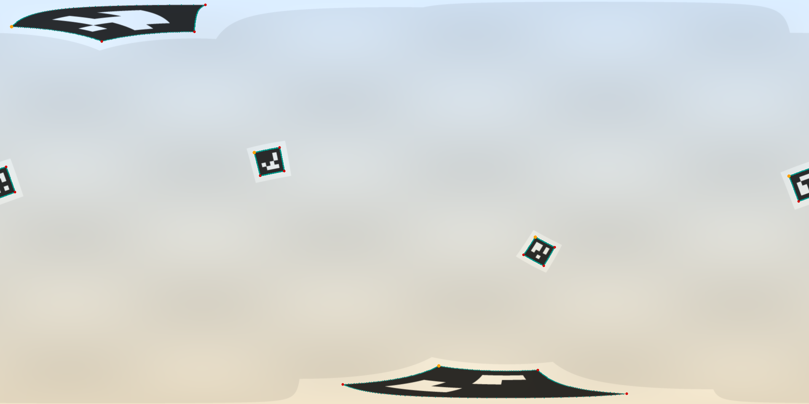

# eqar

Detects ArUco markers directly in equirectangular (360 degree) images. Rust library with
Python bindings. No cube-map or perspective-view expansion: the markers are found, decoded
and refined on the sphere, so a marker at a pole or across the left/right seam is found like
any other, and the corners come back as pixel positions and as unit rays.



*Synthetic 1920 x 960 frame (`docs/make_figure.py`, no real footage). Teal: the detected marker
edges drawn as great-circle arcs; amber dot: corner 0 (top left of the marker's own frame); red
dots: corners 1 to 3.*

## Why great circles

An equirectangular image stretches everything by 1 / cos(latitude) horizontally, and a straight
marker edge is a great circle on the sphere, not a straight line in the image. Near the poles
a marker becomes a wide curved wedge, and across the seam it is split between the two image
borders. Cutting perspective views out of the frame (the usual workaround) costs time and
loses markers that fall between views. eqar instead

- finds candidates on a down-sampled plane (and on two polar-cap projections),
- builds each candidate's quad on the tangent plane of the sphere at the candidate,
- decodes the bits there, and
- fits each of the four edges as a great circle to the full-resolution pixels, so the corners
  are intersections of great circles, independent of where on the sphere the marker is.

## Install

Releases are published as GitHub Release assets only (nothing is on PyPI or crates.io).

**Python** (3.9 or newer; one `abi3` wheel per platform: Linux x86_64 / aarch64, macOS arm64 /
x86_64, Windows x64). `--find-links` alone cannot be combined with `--no-index` because pip
then cannot fetch numpy, so install numpy first:

```sh
pip install numpy
pip install eqar --no-index --find-links https://github.com/yukis-git/eqar/releases/expanded_assets/v0.1.0
```

(`--no-index` keeps pip from picking a different project named `eqar` from PyPI.) A single wheel
can also be installed by its URL from the release page, or from a checkout with
`pip install .` (needs a Rust toolchain; uses maturin).

**Rust** (1.80 or newer; no dependencies):

```toml
[dependencies]
eqar = { git = "https://github.com/yukis-git/eqar", tag = "v0.1.0" }
```

## Quick start (Python)

```python
import cv2, eqar

img = cv2.imread("frame.jpg")                  # uint8 (H, W, 3) BGR; width must be 2 * height
for m in eqar.detect(img):                     # dictionary "4x4_50" by default
    print(m)
# Marker(id=11, center=(639.50, 383.50), side_px=56.8, quality=1.00, flags=SCAN)
```

Video: keep a `Detector`, scan once, then track (a tracked call costs a fraction of a scan).
`Detector` defaults to `time_budget_ms=2.0`, which at 4K covers only a few markers per scan; with
many markers pass `time_budget_ms=None` and check `det.last_stats["n_budget_dropped"]`:

```python
det = eqar.Detector(3840, 1920, dictionary="4x4_50")
markers = det.detect(frame0)
for frame in frames:
    markers = det.track(frame, markers) if markers else det.detect(frame)
    for m in markers:
        print(m.id, m.corners)                 # (4, 2) float32 pixels, TL TR BR BL of the marker
```

Other calls: `det.track(img, markers, frame_gap=3)` after skipped frames;
`det.verify(img, [eqar.Prior(id, rays, sigma_deg)])` to look for known ids near known positions;
`eqar.generate_marker(id, "4x4_50", size=400)` to render a marker to print; `format="rgb"` for RGB
arrays; `(H, W)` grey arrays need no format.

## Quick start (Rust)

```rust
use eqar::{Detector, ImageView, Params, PixelFormat};

fn main() -> Result<(), eqar::EqarError> {
    let (w, h) = (3840, 1920);
    let gray = vec![0u8; w * h];                       // your frame, row-major
    let mut det = Detector::new(w, h, &Params::default())?;
    let img = ImageView::packed(&gray, w, h, PixelFormat::Gray8);
    let mut markers = det.detect(&img)?;
    for m in &markers {
        println!("id {} corners {:?} quality {:.2}", m.id, m.corner_px, m.quality);
    }
    if !markers.is_empty() {
        markers = det.track(&img, &markers, 1)?;       // next frame
        println!("{} markers tracked", markers.len());
    }
    Ok(())
}
```

## API summary

| Python | Rust | |
|---|---|---|
| `eqar.detect(img, dictionary="4x4_50", *, format="bgr", ...)` | | one-off scan (builds a detector for the image size) |
| `eqar.Detector(width, height, dictionary, *, quality, max_markers, time_budget_ms, use_second_scale, reject_high_resid, expect_id, gamma_lut, in_use_ids, coast_max)` | `Detector::new(w, h, &Params)` | one per image size; one thread per detector |
| `det.detect(img)` | `detect(&ImageView)` | full-frame scan |
| `det.track(img, markers, frame_gap=1)` | `track(&ImageView, &[Marker], frame_gap)` | follow markers; falls back to a scan |
| `det.verify(img, priors)` | `verify(&ImageView, &[Prior])` | known id near a known position |
| `det.reset()` | `reset_track()` | forget tracked markers |
| `det.last_timings`, `det.last_stats`, `det.proposals(img)` | `last_timings()`, `last_stats()`, `proposals()` | diagnostics |
| `eqar.generate_marker(id, dictionary, size)` | `generate_marker(dict, id, cell_px)` | render a marker |
| `eqar.Marker`, `eqar.Prior` | `Marker`, `Prior` | results and priors |

`Marker` fields (Python attributes, NumPy arrays are copies): `id`, `corners` (4x2 float32, pixels),
`rays` (4x3 unit vectors), `center`, `center_ray`, `corner_valid` (False where a corner is hidden
or completed and must not be used as a measurement), `corner_flags`, `corner_sigma_scale`,
`quality` (0..1), `flags` (`FLAG_SCAN`, `FLAG_TRACK`, `FLAG_POLE_CAP`, `FLAG_LEAN`, ...), `side_px`,
`edge_resid_px`, `contrast_dn`, `min_cross`, `reject_code`, `prov`, `n_bit_errors`, `border_fail`,
`n_erased`, plus `to_dict()` and a readable `repr`. `__init__.pyi` ships type stubs.

Parameters worth knowing: `max_markers` (default 32) caps the number of markers returned by
every call (there is no `threads` option: eqar is single threaded); `time_budget_ms` bounds the work after the
proposal stage and drops candidates it does not reach (`eqar.detect` defaults to `None`, no
limit; `Detector` defaults to 2.0 for video. On an Apple M4 a 12-marker 3840 x 1920 synthetic
frame returned 4 markers with 2 ms and all 12 with `None`, so with many markers pass
`time_budget_ms=None` and check `last_stats["n_budget_dropped"]`); `quality="lean"` trades decode effort for speed; `in_use_ids` / `expect_id` restrict
which ids are accepted. All 16 OpenCV predefined dictionaries from `4x4_50` to `7x7_1000` are
available (`eqar.DICTIONARIES`).

Bad input raises `ValueError` (wrong shape or dtype, size mismatch, out-of-range parameter),
`TypeError` (not a NumPy array, unknown keyword) or `OverflowError` (an integer parameter that
does not fit its type, e.g. a negative `max_markers` or `expect_id=2**40`);
`track` with nothing to follow raises `RuntimeError`. The Rust API returns `Result<_, EqarError>`
and does not panic on caller input. Calls release the GIL; a detector shared between Python
threads is serialised internally.

## Input requirements

- `uint8` pixels: `(H, W)` grey, or `(H, W, 3)` BGR (default) or RGB. Strided NumPy views are
  used without copying when each row is contiguous; other layouts are copied.
- Equirectangular: `width == 2 * height`, `width` a multiple of 4, `320 <= width <= 16384`.
  The image must cover the full sphere (longitude -180 to 180 left to right, latitude +90 to
  -90 top to bottom).
- A `Detector` is bound to one size. Pixel coordinates put pixel centres at integer values
  (OpenCV convention). Rays are `(cos lat cos lon, sin lat, cos lat sin lon)`.

## Output order

Corners are ordered TL, TR, BR, BL in the marker's own frame (the frame in which the code reads
upright), not in the image frame, so the order is the same wherever the marker is on the sphere.
`rays[i]` and `corners[i]` are the same corner. A marker straddling the seam simply has corners near both
ends of the image width (`FLAG_SEAM` is reserved and never set).

## Benchmarks

Measured by `bench/bench.py` on synthetic frames, one thread, 100 frames of one marker each
(random direction on the sphere including poles and seam, blur sd 0.8 px, noise sd 3), on an
Apple M4 under a load average of 10 to 20 from other jobs (so thread CPU time is reported).
Details, conditions and per-method settings are in [`bench/RESULTS.md`](bench/RESULTS.md).

3840 x 1920:

| method | detected | median corner error (px_eq) | CPU ms / frame |
|---|---|---|---|
| eqar | 99 / 100 | 0.019 | 1.7 |
| cv2.aruco on the equirectangular image (tuned) | 87 / 100 | 0.215 | 197 |
| cv2.aruco on 20 perspective views | 99 / 100 | 0.240 | 108 |

At 1920 x 960 eqar detected 96 / 100 (median 0.030 px_eq, 0.8 ms) against 99 / 100 for the 20 views
(see RESULTS.md). The cv2 rows are not a claim about OpenCV in general: the tuning is mine and
the frames are synthetic. Error is in equivalent pixels (2 pi / width rad).

Corner accuracy of the detector itself, on the fixed grid used to validate the port (20 poses of
an id 0 marker with a side of 60 px_eq at 3840 x 1920, roll varying, PSF sd 0.8 px, noise sd 3,
mean of the four corner errors, median of the 20): **0.0224 px_eq** (max 0.0383), the same 0.0224 /
0.0383 as the C++ implementation on the same frames. Rendered with this repository's own
anti-aliased renderer, no JPEG.

Speed against the C++ implementation it was ported from (3840 x 1920, one marker, one thread,
thread CPU time, earlier measurements with a throw-away harness that is not included): scan 0.94 ms
(Rust) vs 0.80 ms (C++), track 0.12 ms vs 0.11 ms.

## Limitations

- **Single threaded.** One detector uses one thread; run several detectors for parallelism.
- **Real footage: no accuracy advantage was demonstrated.** On real footage from one stitched
  360 degree camera the corner accuracy advantage over conventional detection was not
  demonstrated (stitching parallax and asymmetric blur dominate the error). The accuracy figures
  here are synthetic. The synthetic median is 0.0224 px_eq only under the conditions stated in
  the Benchmarks section (flat marker, side 60 px_eq, blur sd 0.8, noise sd 3, no compression).
  The port was run end to end on a 1920 x 960 annotated stand-in clip, not on the full-resolution
  footage, so full-clip parity with the C++ implementation on real frames is not claimed.
- **Not a pose estimator.** It returns the marker's corners (pixels and rays) and flags. It does
  not estimate a camera or marker pose; feed the corners to your own estimator and respect
  `corner_valid` and `corner_sigma_scale`.
- **No x86 SIMD.** NEON kernels are used on aarch64; on x86_64 the scalar code runs (slower than
  the numbers above, which are from an Apple M4). The cross-check against the C++ implementation
  was run on aarch64 (macOS). CI also runs the test suite on x86_64 Linux and Windows, where it
  selects a looser corner tolerance (0.02 px instead of 0.002 px) because the build has no fused
  multiply-add and a different libm. Speed on x86_64 has not been measured.
- **The relaxed selection path is not exercised by the test scenes** (`prov == PROV_RELAXED`,
  a known-id re-fit of a contour the strict selection rejects); it ports the C++ logic but was
  never observed to run.
- **`Detector`'s 2 ms default `time_budget_ms` is wall-clock and small.** It drops candidates
  it does not reach (`last_stats["n_budget_dropped"]`): a 12-marker 3840 x 1920 synthetic frame
  on an Apple M4 returned 4 markers with 2 ms and all 12 with `None`, so at 4K the default covers
  only a few markers per scan, and on a loaded machine fewer. Users with many markers should pass
  `time_budget_ms=None` (also deterministic). `eqar.detect` defaults to `None`.
- Only the 16 OpenCV predefined dictionaries; flat square markers; width at least 320.
- In an informal synthetic check, markers on a mid-grey background (128) with a light (220)
  quiet zone were not detected, while the same markers on a light background were. Print
  markers with a light margin.

## Provenance

Ported from a C++ implementation and checked for agreement against it on synthetic fixtures
(`tests/fixtures`, produced by the C++ code; see `crates/eqar/tests/parity_*.rs`).

## Related work

Tatta, Sakata, Jinki, Horita, "Self-position estimation of construction equipment using a
360-degree camera and UAV marker," IEICE Trans. Fundamentals, vol. E108-A, no. 7, pp. 917-919,
2025, DOI [10.1587/transfun.2024IML0001](https://doi.org/10.1587/transfun.2024IML0001). Related
prior work, not the source of this detector.

## Development

```sh
cargo fmt --check && cargo clippy --all-targets -- -D warnings && cargo test --release
cargo clippy --workspace --all-targets -- -D warnings      # also checks the Python extension
pip install maturin numpy pytest && maturin develop --release && pytest
```

The Python extension crate (`crates/eqar-py`) is excluded from the root `cargo test`; its tests are
in `tests/py` (NumPy only; a pure-NumPy projector pastes generated markers into synthetic frames).

## Citation and licence

Author: Yuki Sakata. See `CITATION.cff`. Licensed under MIT OR Apache-2.0
(`LICENSE-MIT`, `LICENSE-APACHE`). The ArUco dictionary tables are derived from OpenCV
(Apache-2.0); see `NOTICE`.

---

## 日本語の要約

eqar は、正距円筒（360度）画像の中で ArUco マーカーを直接検出するライブラリです（Rust 本体と Python
バインディング）。キューブマップや透視投影への展開をせず、球面上で検出・復号・精密化するため、極付近や
左右の継ぎ目をまたぐマーカーも他の場所と同じように見つかります。マーカーの辺は球面上の大円なので、
各辺を大円として当てはめ、角を大円どうしの交点として求めます。

- インストール: GitHub Release から（`pip install numpy` のあと
  `pip install eqar --no-index --find-links <Release のURL>`）。Rust は git 依存で使えます。
- 入力: uint8 のグレー `(H, W)` または `(H, W, 3)`（既定 BGR、RGB も可）。`width == 2 * height`、
  幅は 4 の倍数、320 以上 16384 以下。
- 出力: 角はマーカー自身の座標系で TL, TR, BR, BL の順。ピクセル座標と単位レイの両方を返します。
- 合成画像での精度の中央値は 0.0224 px_eq（上記の条件）。合成フレームでの比較は `bench/RESULTS.md`
  に条件つきで記録しています。
- 制限: 単一スレッド。1つの360度カメラ（スティッチ済み）の実写では、角の精度の優位は示せていません
  （スティッチの視差と非対称なぼけの影響）。姿勢推定器ではありません。x86 の SIMD 経路はありません。
  緩和選択（relaxed）経路はテストシーンでは通っていません。フル解像度の実写クリップでの一致は確認して
  いません（1920x960 の注釈付き代替動画でのみ実行）。
- 由来: C++ 実装からの移植で、合成フィクスチャ上で C++ との一致を確認しています。関連研究として
  Tatta, Sakata, Jinki, Horita, IEICE Trans. Fundamentals E108-A(7):917-919, 2025
  （DOI 10.1587/transfun.2024IML0001）がありますが、本検出器の出典ではありません。
- 著者: Yuki Sakata。ライセンス: MIT OR Apache-2.0。
